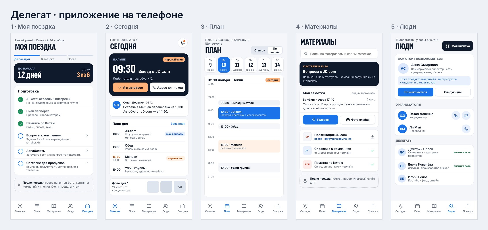
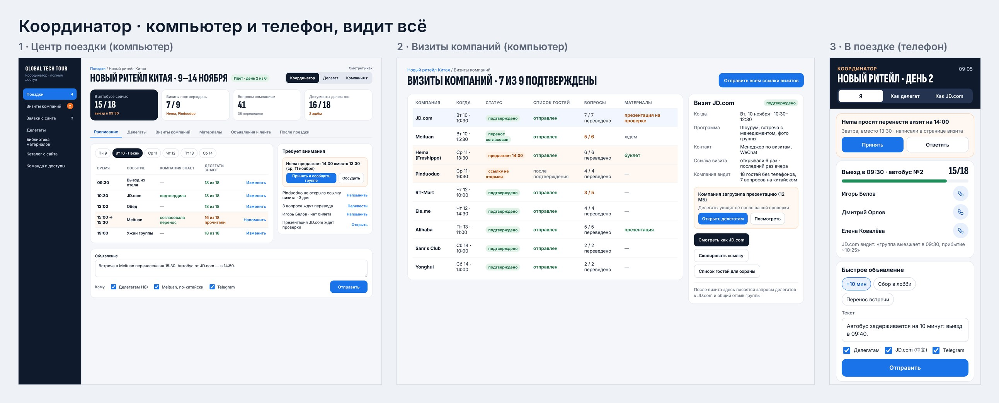
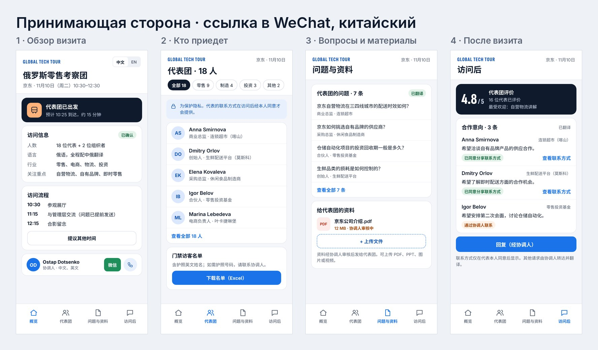
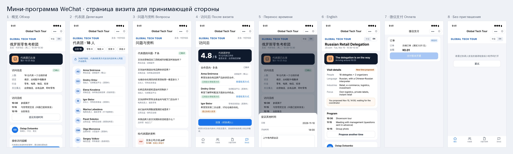

# Global Tech Tour — приложение

Мобильное приложение (iOS и Android) и веб-панель для бизнес-экспедиций Global Tech Tour
([globaltechtour.ru](https://globaltechtour.ru)): одна поездка — три роли.

| Роль | Где работает | Что делает |
| --- | --- | --- |
| Делегат | Приложение на телефоне | Программа по дням, «Сегодня», материалы и заметки, люди группы, подготовка и итоги поездки |
| Координатор | Приложение и панель на компьютере | Собирает поездку, согласует визиты, ведёт группу; видит и меняет всё, смотрит глазами делегата и компании |
| Принимающая сторона | Ссылка в WeChat или браузере, китайский и английский | Подтверждает визит, видит гостей и их вопросы, загружает материалы, получает запросы после визита |

**Статус (15.10.2026):**
- приложение — согласуем сценарии и экраны; после «да» пользователя — прототип на Expo (экраны делегата, Expo Go);
- мини-программа WeChat для принимающей стороны — код и сервер готовы, ждут аккаунта мини-программы
  ([чек-лист](docs/wechat-mini-program.md#чек-лист-что-нужно-от-вас)).

Репозиторий публичный: секретов и настоящих персональных данных в нём нет, только вымышленные демо-данные.

## Где что лежит

| Папка | Что внутри |
| --- | --- |
| [`docs/architecture.md`](docs/architecture.md) | Архитектура: роли, кто что видит, сценарии, схема, экраны, данные, технологии, Китай, этапы |
| [`docs/decisions.md`](docs/decisions.md) | Журнал решений пользователя и предложений, ждущих «да» |
| [`docs/wechat-mini-program.md`](docs/wechat-mini-program.md) | Мини-программа WeChat: что сделано и чек-лист запуска |
| [`design/`](design/README.md) | Макеты экранов по ролям: файлы холста, PNG-превью, листы-обзоры |
| [`miniprogram/`](miniprogram/README.md) | Мини-программа WeChat: страница визита для принимающей стороны и оплата |
| [`server/`](server/README.md) | Сервер мини-программы: вход WeChat, визиты, уведомления, WeChat Pay, бот WeCom |
| [`tools/`](tools) | Превью дизайна, иконки, проверка мини-программы (`mp-check.mjs`), загрузка в WeChat (`mp-ci.mjs`) |
| [`.github/workflows/`](.github/workflows) | «Проверки» при каждом пуше; «Мини-программа WeChat» — QR предпросмотра и загрузка версии вручную |
| [`CLAUDE.md`](CLAUDE.md) | Правила работы с репозиторием для сессий Claude |

Рабочие версии с комментариями:
- **кликабельный прототип** (три роли, кнопки работают) — https://claude.ai/artifact/WqVbtPczcM5Vny7N5f1Jym, исходник `design/prototype/index.html`
- документ архитектуры — Claude Docs, https://claude.ai/artifact/6nudCcLPP5eTTKeu6WhLGp
- холст с экранами — Claude Design, https://claude.ai/artifact/8Tw2bADzTCNwschFSXRMAy

