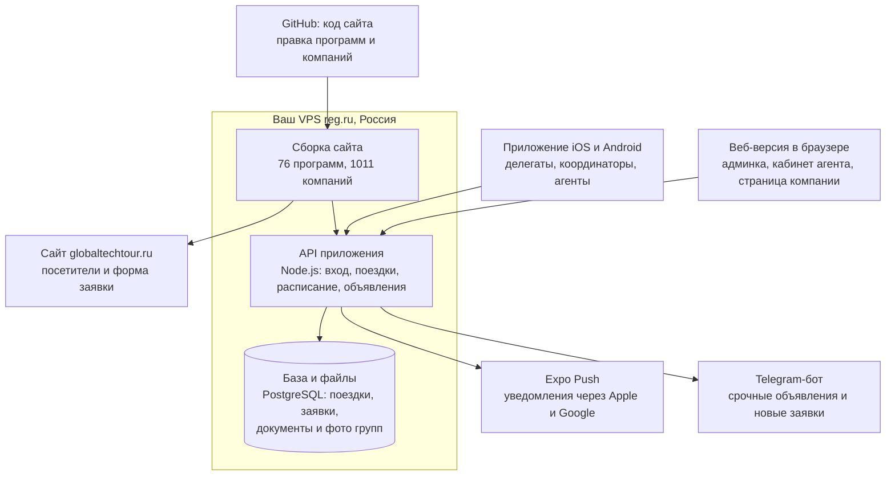

# Приложение Global Tech Tour: архитектура

Обновлено 16.10.2026. Рабочая версия с комментариями — Claude Docs:
https://claude.ai/artifact/6nudCcLPP5eTTKeu6WhLGp (правки вносятся там и переносятся сюда).

Одна система для четырёх ролей: делегат и координатор работают в приложении на iOS и Android, принимающая сторона — по ссылке в браузере или WeChat, без установки, на китайском, агенты и турагентства — в своём кабинете: каталог программ по странам и датам и заявки за своих клиентов. Координатор видит всё и может открыть любой экран глазами делегата или компании. Делаем на React Native + Expo, каталог берём с globaltechtour.ru, сервер ставим на ваш VPS reg.ru.

## Роли

Делегат, координатор и принимающая сторона работают с одной и той же поездкой, но видят её с разных сторон; агент работает с каталогом и своими заявками. Роль задаёт сервер при входе.

| Роль | Кто это | Где работает | Главная задача |
| --- | --- | --- | --- |
| Делегат | Участник экспедиции | Приложение на телефоне | Знать, куда и когда идти, подготовиться к встречам, собрать контакты и заметки |
| Координатор | Вы и ваша команда | Приложение и панель на компьютере | Собрать поездку, согласовать визиты, вести группу в дороге; видит и меняет всё |
| Принимающая сторона | Менеджер компании, куда едет группа (PR, BD, шоурум) | Ссылка в браузере или WeChat, китайский и английский | Подтвердить визит, узнать, кто едет и что их интересует, встретить вовремя, получить запросы после визита |
| Агент | Турагентство или агент-партнёр, который продаёт программы GTT своим клиентам | Приложение на телефоне и кабинет в браузере | Видеть программы по странам, ближайшие выезды и свободные места, отправлять заявки за клиентов и следить за статусом, брать материалы для клиентов |

Принимающая сторона не ставит приложение: в Китае нет Google Play, а компании не ставят чужие приложения ради одного визита. Она получает ссылку на страницу своего визита и видит только его. Каталог программ для будущих клиентов остаётся открытой частью приложения, без входа.

## Кто что видит

Координатор видит и меняет всё; делегат видит свою поездку; принимающая сторона — только свой визит и без личных контактов делегатов.

| Раздел | Функция | Делегат | Координатор | Принимающая сторона |
| --- | --- | --- | --- | --- |
| Программа | Расписание по дням и часам | Вся поездка | Вся поездка, правит | Только свой визит |
| Программа | Перенос времени или места | — | Меняет, группа получает уведомление | Предлагает другое время, координатор подтверждает |
| Программа | Где сейчас группа | Отмечается «Я в автобусе» | Видит, кого нет, звонит в одно нажатие | Видит время прибытия: «будут через 15 мин» |
| Программа | Переезды: «Выехали» и «Прибыли» (решение 16.10.2026) | Видит «в пути, выехали в 09:34» | Отмечает выезд и прибытие одной кнопкой, время можно поправить на ±1–5 мин; приложение считает время в пути и пишет журнал «факт против плана» | Видит «группа выехала» и время прибытия |
| Программа | Погода по дням | Прогноз в плане каждого дня и на «Сегодня» | Видит то же | — |
| Программа | Отели по дням | Название, адрес по-китайски для такси, описание, телефон | Вносит из брони | — |
| Программа | Рестораны: обед и ужин | Место, адрес по-китайски, кухня, варианты меню; своё меню из профиля и карточка для официанта | Вносит брони, отправляет ресторану сводку питания и аллергий группы на китайском, без имён | — |
| Программа | Культурная программа | Описание, время, что взять — если предусмотрена программой | Вносит и меняет | — |
| Свободное время | «Город»: шопинг, ночная жизнь | Подборка мест рядом с отелем на карте: что там, часы, адрес на 3 языках, «Такси сюда» | Делает подборку для каждого города | — |
| Свободное время | Магазины 24/7 и туалеты | На карте рядом с собой, поиск по карте Amap | — | — |
| Свободное время | Такси | DiDi с адресом по-китайски; «Показать водителю» для такси на улице | — | — |
| Свободное время | «Иду гулять» | Отмечается сам: до какого часа вернётся, «Я в отеле»; где он — не отслеживается | Видит, кто гуляет самостоятельно и кто вернулся | — |
| Люди | Профиль делегата (решение 16.10.2026) | Заполняет сам: питание (несколько вариантов), аллергия — на что именно и насколько серьёзно, номер и сосед, здоровье, английский, мессенджер, интересы; при аллергии — карточка для официанта по-китайски | Видит профиль каждого — «кто есть кто», своя заметка о делегате, «Напомнить заполнить»; сводка питания группы | Видит только имя, должность и компанию |
| Люди | Список делегатов | Имя, должность, тип компании, город | Всё, включая документы и оплату | Должность, тип компании, отрасль — без телефонов |
| Люди | Список гостей для пропуска | — | Собирает и отправляет | Получает ФИО латиницей; паспорт — только если требует охрана |
| Люди | Контакты и визитки | Обмен через QR с другими делегатами | Все контакты | Только тех, кто сам запросил связь |
| Люди | «С кем познакомиться» | Видит подсказки | Видит и сам сводит людей | — |
| Материалы | Памятка, программа, справки о компаниях | Читает, скачивает для офлайна | Загружает и закрепляет | — |
| Материалы | Закреплённые презентации | Наверху «Материалов»: презентация поездки и компаний, без интернета | Закрепляет и снимает | — |
| Материалы | Презентация компании | Видит после проверки координатора | Проверяет и публикует | Загружает к своему визиту |
| Материалы | Вопросы к встрече | Задаёт заранее | Собирает, переводит, отправляет | Получает на китайском до визита |
| Материалы | Личные заметки и фото слайдов | Видит только он сам | — | — |
| Общение | Объявления | Читает | Пишет группе или одному, видит, кто прочитал | — |
| Общение | Лента: фото дня, опросы | Смотрит, голосует | Публикует | — |
| Общение | Связь с координатором и контакты | Кнопка на главном экране: звонок, сообщение; все контакты поездки и экстренные номера Китая | Задаёт контакты поездки | Звонок, WeChat |
| Документы | Паспорт, билеты, страховка, оплата | Свои, загружает сам | Всех, статусы, напоминания | — |
| После визита | Запросы: образцы, переговоры, повторная встреча | Отправляет | Видит все и ведёт | Получает запросы к своей компании |
| После визита | Отзыв о визите | Ставит оценку | Видит все оценки | Видит общий отзыв без имён |
| После поездки | Фото и видео, итоговый отчёт | Открываются после поездки | Загружает | — |
| После поездки | Отзыв о поездке текстом или видео | Пишет или записывает видео до 2 минут, даёт или не даёт согласие на публикацию | Получает, благодарит, с согласия берёт в соцсети и на сайт | — |
| Управление | «Смотреть как делегат / как компания / как агент» | — | Переключатель в шапке | — |
| Управление | Поездки, заявки с сайта и от агентов, доступы команды и агентств | — | Всё | — |

**Агенты и турагентства (решение 16.10.2026).** Отдельный кабинет для партнёров, которые продают программы GTT своим клиентам. Доступ агентству даёт координатор приглашением, вход — по почте и одноразовому коду.

| Функция | Агент | Координатор |
| --- | --- | --- |
| Каталог программ | Все программы по странам: маршрут, дни, компании — с сайта globaltechtour.ru | Правит на сайте, как сейчас |
| Выезды и места | Ближайшие даты по месяцам и свободные места | Ведёт даты и места |
| Заявка за клиента | Программа, даты из списка или свои, число участников, клиент, комментарий; статус «отправлена → в работе → подтверждена» | Получает в приложении и в Telegram, берёт в работу, подтверждает; подтверждённая заявка занимает места в выезде |
| Данные участников | Имена, паспорта и телефоны — только после подтверждения заявки, на сервере в России | Все |
| Материалы для клиентов | Презентации программ (PDF без цен), ролики и фото | Загружает |
| Стоимость для агента и комиссия | Поля в карточке программы, в условиях сотрудничества и в расчёте; пока не заполнены (решение 16.10.2026) | Заполняет, когда решит |
| Запрос на расчёт | Конструктор из блоков: готовая экспедиция из каталога (можно с правками) или своя программа — страна, города, отрасли, компании (или «подберите за нас»), цели; группа — число участников, гражданство по странам (Россия и СНГ), кто едет, язык; даты; город вылета, перелёт, отели и размещение; что включить; клиент, бюджет, срок ответа, комментарий, файл ТЗ клиента. Статус «отправлен → считаем → расчёт готов» | Получает готовое ТЗ (в приложении, PDF, Telegram), берёт в расчёт, отправляет расчёт |
| Гражданство и визы | Указывает, из каких стран участники (смешанная группа — несколько строк) | Видит в ТЗ отметку о визе по таблице «страна поездки × гражданство», которую ведёт сам |
| Чужие данные | Не видит делегатов, поездку изнутри и других агентов | Видит все заявки агентов и с сайта, «Смотреть как агент» |

## Сценарии

Каждая роль проходит три этапа — до, во время и после поездки, а координатор связывает делегатов с компаниями: вопросы, список гостей, переносы и запросы после визита идут через него.

| | До поездки | В поездке | После |
| --- | --- | --- | --- |
| **Делегат** | Приглашение, «Моя поездка»: паспорт, интересы, вопросы компаниям | «Сегодня», «Я в автобусе», заметки и QR-знакомства на визитах | Фото и отчёт, «Хочу продолжить», отзыв |
| **Координатор** | Собирает поездку, приглашает делегатов, открывает визиты, переводит вопросы | Ведёт группу: кто в автобусе, переносы, объявления | Фото и отчёт, передаёт запросы компаниям, смотрит отзывы |
| **Принимающая сторона** | Ссылка в WeChat: подтверждает время, видит гостей и вопросы, загружает материалы | Видит, когда приедет группа, связь с координатором в WeChat | Оценка группы, запросы с контактами по согласию |

Делегат и компания не пишут друг другу напрямую: вопросы, список гостей и запросы идут через координатора, контакты передаются только с согласия делегата.

**Делегат**

1. **До поездки.** Получает ссылку-приглашение, ставит приложение и видит «Мою поездку» со списком дел: загрузить паспорт, указать отрасль и интересы, прочитать памятку, задать вопросы компаниям.
2. **Накануне.** Материалы скачиваются в телефон, приходит напоминание о сборе.
3. **Утро в поездке.** Экран «Сегодня»: выезд через 25 минут, кнопка «Я в автобусе», адрес для такси по-китайски, объявления и фото дня.
4. **На визите.** Карточка компании и свои вопросы перед глазами; заметки голосом и фото слайдов; знакомства через QR.
5. **Изменения.** Перенесли встречу — приходит уведомление, план уже обновлён.
6. **После поездки.** Фото и видео, контакты, кнопка «Хочу продолжить» (образцы, переговоры) и отзыв.

**Координатор**

1. **Сборка поездки.** Создаёт поездку из программы сайта: дни и компании подставляются, остаётся поставить даты и время.
2. **Делегаты.** Приглашает ссылками, следит за паспортами, билетами и оплатой, напоминает одним нажатием.
3. **Визиты.** Для каждой компании открывает карточку визита: отправляет ссылку принимающей стороне, список гостей и вопросы делегатов в переводе; получает подтверждение времени и материалы.
4. **В поездке.** С телефона видит, кто в автобусе, звонит отстающим, шлёт объявления по шаблонам; переносит событие — группа и компания узнают сразу.
5. **Проверка.** В любой момент включает «Смотреть как делегат» или «как JD.com» и видит ровно то, что видят они.
6. **После.** Загружает фото и итоговый отчёт, передаёт компаниям запросы делегатов, смотрит отзывы, предлагает следующую поездку.

**Принимающая сторона**

1. **Приглашение.** Получает ссылку на страницу визита в WeChat или по почте, без регистрации.
2. **Подготовка.** Видит дату и время, сколько человек и кто они (должности и отрасли), их вопросы на китайском; подтверждает время или предлагает другое.
3. **Материалы.** Загружает презентацию и буклет; при нужде получает список гостей для пропуска.
4. **День визита.** Видит, что группа выехала и будет через 15 минут; связь с координатором в WeChat.
5. **После визита.** Получает запросы делегатов на продолжение с контактами тех, кто это разрешил, и общий отзыв группы.

**Агент**

1. **Доступ.** Координатор приглашает агентство ссылкой; вход по почте и одноразовому коду.
2. **Подбор.** Каталог по странам, карточка программы: маршрут, компании, ближайшие выезды и свободные места; презентация программы без цен — отправить клиенту.
3. **Заявка.** Программа, даты из списка или свои, число участников, клиент и комментарий. Заявка уходит координатору в приложение и в Telegram.
4. **Статус.** «Отправлена → в работе → подтверждена»; подтверждённая заявка занимает места в выезде. Дальше — договор и список участников.
5. **Расчёт.** Если готовой даты нет или клиенту нужна своя программа — «Запрос на расчёт» из блоков: готовая экспедиция или своя программа, группа и гражданство, даты, перелёт и отели, что включить, клиент и срок. Координатор получает готовое ТЗ, считает и отправляет расчёт; агент видит статус «отправлен → считаем → расчёт готов».

## Схема

Приложение и админка работают через один API на вашем VPS; каталог правится как сейчас, на сайте, и приходит в приложение после сборки. Заявки с формы сайта попадают в ту же базу и, как сейчас, в Telegram.

## Экраны

Все экраны собраны в макете [«Приложение GTT: варианты интерфейса»](https://claude.ai/artifact/8Tw2bADzTCNwschFSXRMAy), страница «Сценарии по ролям»: три ряда, по одному на роль, вкладки и кнопки кликабельны. Копия макета с превью — [`design/`](../design/README.md). Пример везде один — поездка «Новый ритейл Китая», 9–14 ноября, и визит в JD.com.

**Делегат** — приложение на телефоне, пять вкладок

1. Сегодня — ближайшее событие крупно, кнопка «Я в автобусе», адрес для такси по-китайски, связь с координатором в одно нажатие, погода и отель, объявление координатора, план дня
2. План — дни поездки с погодой и отелем (адрес по-китайски, описание, телефон); визиты, обеды и ужины в забронированных ресторанах (кухня, варианты меню), культурная программа, если она есть; перенесённые встречи отмечены
3. Материалы — закреплённые презентации (поездки и компаний) наверху, памятка, программа, справки о компаниях; всё скачивается для работы без интернета; свои заметки
4. Люди — связь с координатором и все контакты (координатор, переводчик, отель, экстренные номера Китая), «Вам стоит познакомиться», список делегатов
5. Поездка — этапы «до, в поездке, после»: подготовка (паспорт, интересы, предпочтения в еде, вопросы компаниям); культурная программа; после поездки — отзыв текстом или видео, оценка визитов, «Хочу продолжить», фото и отчёт

**Координатор** — панель на компьютере и приложение на телефоне; видит и меняет всё

1. Центр поездки (компьютер) — разделы: поездки, визиты компаний, заявки с сайта, делегаты, библиотека материалов, каталог, команда и доступы. Сводка (кто в автобусе, визиты, вопросы, документы), расписание с отметками «компания знает» и «делегаты знают», блок «Требует внимания» и объявление в один клик
2. Визиты компаний (компьютер) — все 9 компаний маршрута: статус, список гостей, вопросы в переводе, материалы на проверке; карточка визита со ссылкой для компании
3. В поездке (телефон) — запросы компаний на перенос, кто ещё не в автобусе со звонком в одно нажатие, быстрое объявление делегатам, компании по-китайски и в Telegram
4. «Смотреть как» — переключатель в шапке: «Делегат», «JD.com» или «Агент» открывает ровно то, что видят они
5. Заявки — запросы на расчёт (открываются как ТЗ: «Взять в расчёт», «Отправить расчёт», PDF) и заявки агентов и с формы сайта: «Взять в работу», «Подтвердить»; новые — и на «Пульте» в «Требует внимания»

**Принимающая сторона** — страница визита по ссылке в WeChat или браузере, китайский и английский, четыре вкладки

1. 概览, «Обзор» — дата и программа визита, где группа и когда приедет, «Предложить другое время», связь с координатором в WeChat
2. 代表团, «Делегация» — 18 гостей: должности, типы компаний, отрасли, без телефонов; список для охраны в Excel
3. 问题与资料, «Вопросы и материалы» — вопросы делегатов на китайском; загрузка презентации, делегаты увидят её после проверки координатора
4. 访问后, «После визита» — общая оценка группы и запросы на продолжение; контакты только тех, кто разрешил, ответ через координатора

**Агент** — приложение и кабинет в браузере, пять вкладок (пока только в кликабельном прототипе)

1. Каталог — 76 программ с сайта по странам: маршрут, дни, компании, ближайший выезд; карточка программы с выездами, местами, презентацией и заявкой
2. Даты — выезды по месяцам, свободные места, заявка в одно нажатие; заявка на свои даты
3. Расчёт — запрос на расчёт из блоков: готовая экспедиция или своя программа (ТЗ), группа и гражданство (Россия и СНГ), даты, перелёт и отели, что включить, клиент и срок
4. Заявки — заявки на места и запросы на расчёт со статусами и ответами координатора
5. Материалы — презентации программ без цен для клиентов, ролики и фото, условия сотрудничества (поля «Стоимость для агента» и «Комиссия агента», пока пустые), связь с координатором

Будущие клиенты без входа видят открытую часть приложения — каталог программ по странам и отраслям, конструктор поездки и заявку, которая уходит координатору и в Telegram, как сейчас с сайта.

## Данные

Каталог не дублируем: программы и компании правятся на сайте, приложение забирает их при каждой сборке сайта. Всё о людях и поездках живёт только на сервере.

| Что | Где хранится | Кто меняет |
| --- | --- | --- |
| Программы (76) и компании (1011) | Репозиторий сайта SINOTECH, `tours.json` и `companies.json`; сайт выкладывает их файлами для приложения | Как сейчас: правка сайта |
| Поездка | Сервер: программа-основа, даты, города, координатор | Координатор |
| Событие расписания | Сервер: день, время, место, адрес по-китайски, компания | Координатор |
| Визит компании | Сервер: компания, время, статус, ссылка с ключом, вопросы в переводе, материалы, запросы после визита | Координатор; другое время предлагает и материалы загружает компания |
| Делегат | Сервер: имя, телефон, почта, поездка, отметки по документам и оплате, предпочтения в еде | Координатор; свои контакты и питание — сам делегат |
| Профиль делегата | Сервер: питание (список), аллергены, «другое», серьёзность, номер и сосед, здоровье, язык, мессенджер, интересы, согласие на сведения о здоровье, заметка координатора | Делегат; заметку пишет координатор |
| Переезд | Сервер: поездка, откуда → куда, план выезда и минут в пути, факт выезда и прибытия, кто отметил | Координатор |
| Отель | Сервер: город, ночи, название, адрес по-китайски, описание, телефон | Координатор, из брони |
| Ресторан | Сервер: время, место, адрес по-китайски, кухня, варианты меню | Координатор, из брони |
| Культурная программа | Сервер: время, описание, что взять | Координатор |
| Место в городе | Сервер: город, категория (шопинг, ночная жизнь), название на 3 языках, что там, часы | Координатор; магазины 24/7 и туалеты — из карты Amap |
| Отзыв | Сервер: текст или видео, согласие на публикацию | Делегат создаёт, координатор ведёт |
| Документы и фото | Сервер, файлы с доступом только у своей группы | Координатор |
| Объявление | Сервер: текст, кому, кто прочитал | Координатор |
| Заявка | Сервер: та же форма, что на сайте (сейчас уходит только в Telegram), или заявка агента (программа, даты, участники, клиент) + статус | Будущий клиент или агент создаёт, координатор ведёт |
| Агентство | Сервер: название, контактное лицо, почта, условия сотрудничества | Координатор |
| Выезд | Сервер: программа, даты, мест всего и занято, стоимость для агента и комиссия (пока пустые) | Координатор; подтверждённые заявки занимают места |
| Запрос на расчёт | Сервер: блоки ТЗ (программа или направление, отрасли, компании, цели, группа, гражданство, даты, перелёт и отели, что включить, клиент, бюджет, срок, файл), статус, расчёт | Агент создаёт, координатор считает |
| Правила въезда | Сервер: страна поездки × гражданство → нужна виза или безвиз, на сколько дней | Координатор |

На телефоне делегата хранится копия его поездки: программа, компании и документы открываются без интернета.

## Технологии

Один язык — TypeScript — и в приложении, и на сервере, как на сайте GTT: типы данных и переводы ru/en переносятся с сайта.

| Часть | Решение | Почему |
| --- | --- | --- |
| Приложение | React Native + Expo: один код → iOS, Android и веб-версия для компьютера | Сайт уже на React; сборка для App Store в облаке Expo без Mac; обновления текстов и экранов — без новой проверки в магазине |
| Сервер | Node.js (TypeScript) + PostgreSQL на вашем VPS reg.ru, за nginx, адрес `globaltechtour.ru/api/app` | Сервер уже оплачен и держит сайт; данные остаются в России |
| Вход делегата | Ссылка-приглашение от координатора (WhatsApp, Telegram, почта) → телефон запоминает вход | Без паролей и платных SMS |
| Вход координатора | Почта + одноразовый код | Админские права не даём по одной ссылке |
| Страница принимающей стороны | Тот же код Expo в веб-версии; ссылка с личным ключом визита, китайский и английский | Открывается в WeChat и браузере без установки; виден только свой визит |
| Уведомления | Expo Push → Apple (APNs) и Google (FCM); срочное дублируется в Telegram через вашего бота | Бесплатно; про Android в Китае — в следующем разделе |
| Карты и такси | Карта и поиск мест — Amap (高德) или Baidu, ключ разработчика на компанию; такси — открытие DiDi с адресом (DiDi есть в виде приложения и внутри WeChat и Alipay) | Google Карты и Uber в Китае не работают |
| Погода | Прогноз по городу и дате из бесплатного погодного сервиса (например, Open-Meteo: без ключа, до 16 дней вперёд); раньше — обычная погода для этого месяца | Ничего не вносить руками; позже можно сделать виджет на экран телефона |
| Каталог | Файлы программ и компаний, которые сайт выкладывает при сборке; логотипы — `globaltechtour.ru/logos` | Один источник, сервер не нагружается |
| Заявки | Нынешний приём заявок сайта (`/api/lead`) дописывает заявку в базу, Telegram остаётся | Заявки с сайта и из приложения в одном списке |
| Код | Репозиторий `Ostap-87/GTT-APP` (публичный) | Секретов и настоящих данных в нём нет; ключи — только в секретах сервера и GitHub |

## Китай и персональные данные

Приложение должно работать там, где его открывают чаще всего, — в автобусе в Китае. Для этого три решения.

- **Без интернета.** Программа поездки, карточки компаний, адреса по-китайски и документы скачиваются в телефон заранее и открываются без сети.
- **Уведомления на Android.** Сервисы Google в Китае заблокированы: на местной китайской сим-карте уведомление может не дойти. На iPhone и в роуминге российской сим-карты работает. Поэтому приложение само проверяет новые объявления при открытии, а срочное дублируется в Telegram.
- **Сервер доступен из Китая.** Ваш VPS reg.ru не зависит от сервисов Google или других зарубежных облаков — проверим скорость на пилотной поездке.
- **Мини-программа WeChat.** Для принимающей стороны есть и второй вход — мини-программа с входом через WeChat и уведомлениями внутри WeChat; код готов, нужен аккаунт мини-программы и сервер в Гонконге или Китае ([wechat-mini-program.md](wechat-mini-program.md)).

**Персональные данные.** Данные граждан России (имя, телефон, скан паспорта) закон 152-ФЗ требует хранить на серверах в России — VPS reg.ru этому подходит. При первом входе делегат даёт согласие на обработку данных; текст согласия и политику конфиденциальности (её требуют и App Store, и Google Play) лучше показать юристу. Аллергии и особенности здоровья из профиля — особая категория персональных данных: их сохраняем только с отдельной галочкой согласия, видит их только координатор, ресторан получает сводку без имён, через 30 дней после поездки они удаляются.

## Адреса, перевод голоса и радиогид

**Адреса на трёх языках (решение 15.10.2026).** У отелей, ресторанов и визитов адрес показан на китайском (крупно, для водителя), русском и английском; каждую строку можно скопировать. Кнопка «Показать водителю» открывает адрес крупно с фразой «请带我去这里» («Отвезите меня сюда»). «Открыть в картах» ведёт в Amap (高德) или Baidu: Google Карты в Китае не работают.

**Голосовой переводчик (предложение).** Режим разговора: человек говорит, приложение распознаёт речь, переводит (китайский ↔ русский ↔ английский), показывает текст и по желанию озвучивает перевод.

- На iPhone — встроенные в iOS распознавание речи и перевод Apple; часть работает без интернета, если языки скачаны заранее.
- На Android и как запасной путь — облачные сервисы, которые работают в Китае: iFlytek (科大讯飞), Tencent Cloud или Alibaba Cloud. Запросы идут через наш сервер, ключи хранятся только на нём, оплата поминутная.
- Сервисы Google и OpenAI в Китае без VPN недоступны — на них не опираемся.
- Ограничения: шум и отраслевые термины снижают точность; на переговорах живой переводчик остаётся.
- Для этих модулей приложение собирается своей сборкой Expo (EAS), а не через Expo Go.

**Радиогид в приложении (предложение).** Гид или переводчик говорит в свой телефон (лучше с петличным микрофоном), делегаты слушают в своих наушниках — проводных или Bluetooth; в шумном цеху слышен голос гида, а не зал.

- Звук в реальном времени с задержкой около 0,2–0,5 секунды: Agora (китайская компания, работает в Китае) или свой сервер LiveKit в Гонконге. Звук играет и при выключенном экране.
- По желанию — субтитры на русском: речь гида распознаётся и переводится.
- Без мобильного интернета — через Wi‑Fi-точку телефона гида; проверим на пилоте.
- Для больших цехов без связи стоит держать запасной аппаратный радиогид (передатчик и приёмники берут в аренду).

**Свободное время (решение 15.10.2026).** Экран «Город»: подборка шопинга и ночной жизни от координатора, магазины 24/7 и туалеты на карте рядом, такси DiDi с адресом по-китайски, отметка «Иду гулять» с временем возвращения — координатор видит, кто гуляет самостоятельно, без отслеживания местоположения.

Оба модуля показаны в прототипе на экране «Сегодня»; трансляцию включает координатор на «Пульте». Поставщиков выберем после проверки на пилотной поездке в Китае.

## Этапы

Каждый этап заканчивается тем, что вы пробуете его на своём телефоне; сроки — ориентир, уточним после первого этапа.

1. **Прототип, ~1 неделя.** Каталог с сайта и экраны делегата на тестовой поездке. Открывается на вашем телефоне через бесплатное приложение Expo Go, без магазинов. *Начат 16.10.2026: код — [`mobile/`](../mobile/README.md).*
2. **Сервер и админка, ~2–3 недели.** Вход по приглашению, поездки, делегаты, расписание, объявления с уведомлениями, заявки с сайта. Админка открывается и на компьютере.
3. **Пилот на одной поездке.** Участники ставят приложение через тестовые ссылки (TestFlight для iPhone, закрытое тестирование Google Play для Android). Собираем замечания в автобусе, а не в офисе.
4. **Публикация.** App Store, Google Play и RuStore; проверка в магазинах занимает от дня до недели.
5. **После поездки.** Фото- и видеопакет, материалы, контакты компаний, предложение следующей экспедиции.

## Что нужно от вас

Для прототипа нужно только ваше «да» на этот документ; остальное — к пилоту и публикации.

- [x] Утвердить роли, экраны и этапы из этого документа — утверждено 16.10.2026
- [ ] Apple Developer Program — $99 в год; с российской картой оплатить нельзя, скорее всего проще оформить из Китая на вас или на компанию
- [ ] Google Play Console — $25 один раз, так же
- [ ] RuStore — бесплатно, для российских телефонов на Android
- [ ] Название в магазинах (предлагаю «Global Tech Tour») и иконка — сделаю варианты в фирменном синем
- [ ] Кто координаторы: имена и почты для доступа в админку
- [ ] Пилотная поездка: какая и когда
- [ ] Текст согласия на обработку данных и политика конфиденциальности — черновик напишу я, проверит юрист
- [ ] Агенты: какие агентства подключаем первыми; когда заполняем поля «Стоимость для агента» и «Комиссия»
- [ ] Правила въезда для таблицы «страна поездки × гражданство» (Россия и СНГ) — заполним вместе перед пилотом
